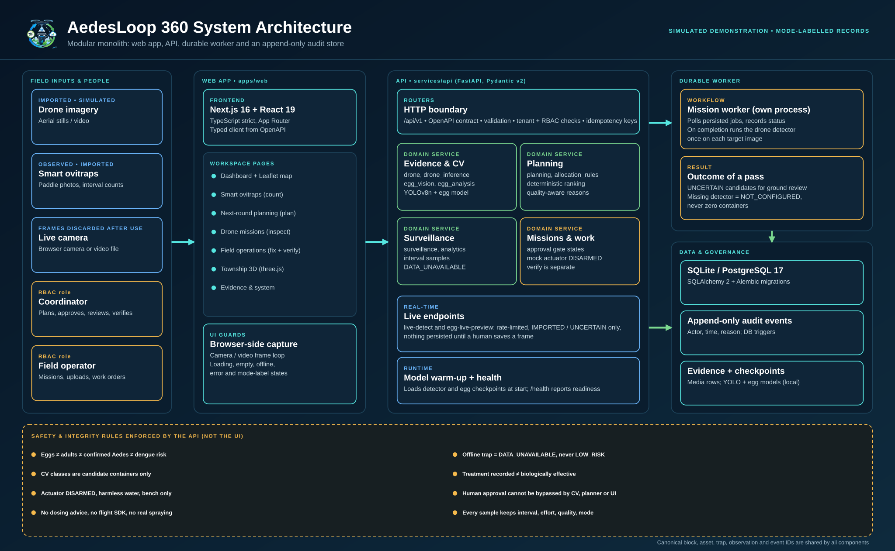
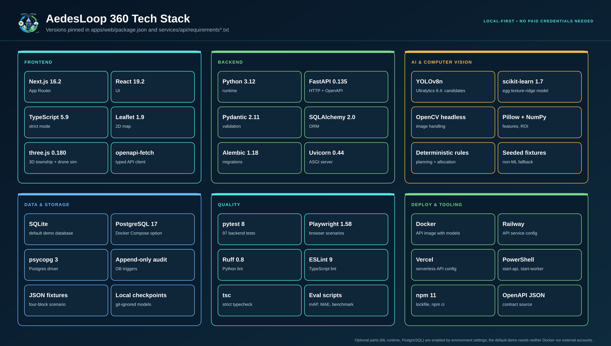

<p align="center">
  
</p>

<h1 align="center">AedesLoop 360</h1>

<p align="center">
  <strong>An AI drone, a smart ovitrap and a township command dashboard, joined by one auditable data loop.</strong><br>
  A local, simulated demonstration of evidence-aware Aedes vector control for Malaysian townships.
</p>

<p align="center">
  <a href="#quick-start">Quick start</a> &middot;
  <a href="#system-architecture">Architecture</a> &middot;
  <a href="#system-flow">Flow</a> &middot;
  <a href="#tech-stack">Tech stack</a> &middot;
  <a href="#results-and-evidence">Results</a> &middot;
  <a href="#documentation-map">Docs</a>
</p>

> **Status:** hackathon MVP and local demonstration, **not** a certified mosquito-control product. Drone activity, treatment and most records are **simulated or imported**. No pesticide is dispensed and no real drone is flown. The product never claims that a container detection proves larvae, that an egg trend proves dengue incidence, or that a recorded treatment proves biological effectiveness.

## Contents

1. [What it does](#what-it-does)
2. [System architecture](#system-architecture)
3. [System flow](#system-flow)
4. [Tech stack](#tech-stack)
5. [What you can do in the app](#what-you-can-do-in-the-app)
6. [Safety and scientific rules](#safety-and-scientific-rules)
7. [Results and evidence](#results-and-evidence)
8. [Quick start](#quick-start)
9. [Run the checks](#run-the-checks)
10. [Repository layout](#repository-layout)
11. [Documentation map](#documentation-map)
12. [Real versus simulated](#real-versus-simulated)
13. [References and licence](#references-and-licence)

## What it does

Dengue control teams spend limited staff hours across many blocks. AedesLoop 360 shows how three tools can feed each other so those hours go where the evidence points:

| Pillar | Job | What it produces |
|---|---|---|
| **AI drone** (inspect and demonstrate targeted action) | A simulated drone pass and a YOLOv8n detector find *candidate* water containers in aerial images. | Candidate findings, always `UNCERTAIN` until a person reviews them. |
| **Smart ovitrap** (monitor and count) | Egg counts per collection interval, with an image-based reviewer-assist counter. | Interval samples that keep their dates, sampling effort, quality and review status. |
| **Command dashboard** (analyse and coordinate) | Ranks blocks, explains why, and routes work to people. | A reviewed plan, work orders, and a separate follow-up verification. |

They are connected by a loop: **observe, plan, inspect, approve, act safely, monitor, re-plan, verify**. Every record shares canonical block, asset, trap, observation and event IDs. Primary track: *People* (healthier townships). Secondary: *Planet* (restrained, source-reduction-first interventions).

## System architecture



The system is a **modular monolith**: a Next.js web app talks to one FastAPI service that owns validation, tenant and role checks, domain logic and state transitions. A separate **durable worker** process completes queued simulated missions and runs the drone detector on each target image. Everything lands in a migrated database with **append-only audit events**. The API, not the UI, enforces the safety rules shown along the bottom of the diagram.

Design rationale: [`docs/ARCHITECTURE.md`](docs/ARCHITECTURE.md) and [`docs/adr/`](docs/adr). More views: [evidence-to-action loop](docs/aedesloop-architecture-slide.svg), [enterprise layers](docs/aedesloop-enterprise-architecture.svg).

## System flow


1. **Capture**: an operator collects drone images, live camera frames and ovitrap counts.
2. **Analyse**: the detector proposes candidate containers; the egg model proposes a count; quality and review state are attached.
3. **Prioritise**: deterministic, capacity-limited rules rank blocks and say why. Missing data stays visible.
4. **Human gate**: a coordinator approves or rejects. The detector, the planner and the UI cannot skip this step.
5. **Operate**: a harmless water-only mock mission, or a source-reduction work order (empty, scrub, cover, remove, repair). Recurring problems create a permanent-correction task.
6. **Verify**: follow-up evidence is a separate event from the action.
7. **Learn**: new interval evidence updates the next plan.

State and approval rules: [`docs/WORKFLOWS_AND_STATES.md`](docs/WORKFLOWS_AND_STATES.md).

## Tech stack



| Layer | Technology |
|---|---|
| Frontend | Next.js 16.2 (App Router), React 19.2, TypeScript 5.9 strict, Leaflet 1.9, three.js 0.180, `openapi-fetch` typed client |
| Backend | Python 3.12, FastAPI 0.135, Pydantic 2.11, SQLAlchemy 2.0, Alembic 1.18, Uvicorn |
| AI and CV | Ultralytics YOLOv8n (candidate containers), scikit-learn texture-ridge model (egg reviewer assist), OpenCV headless, Pillow, NumPy. Planning and allocation are deterministic rules; no LLM is involved in any decision |
| Data | SQLite (default demo), PostgreSQL 17 through Docker Compose, psycopg 3, append-only audit triggers, JSON fixtures |
| Quality | pytest, Playwright, Ruff, ESLint, `tsc --noEmit`, evaluation scripts for mAP, MAE and the allocation benchmark |
| Deploy | Docker images, Railway and Vercel configs, PowerShell start scripts. See [`docs/DEPLOYMENT.md`](docs/DEPLOYMENT.md) (written, not yet run end to end) |

Exact versions are pinned in `apps/web/package.json` and `services/api/requirements*.txt`. Checkpoints and datasets stay local and are ignored by Git.

## What you can do in the app

| Page | Step | What it is for |
|---|---|---|
| **Dashboard** | | What needs attention now: loop strip with live numbers, Leaflet map, block cards, trends, and a folded "How far can you trust this?" with the model evaluation. |
| **Smart ovitraps** | 1. Count | Add an interval count from a paddle photo, aim a live camera preview, watch trap history, record corrections and device service. |
| **Next-round planning** | 2. Plan | Turn counts into a ranked list of blocks with reasons. A coordinator approves it. Includes the simulated allocation comparison. |
| **Drone missions** | 3. Inspect | Run a simulated mission, review each candidate finding, use live detection from a camera or video file. |
| **Field operations** | 4. Fix and verify | Assign jobs, record the fix, then have a second person verify it. Per-site history. |
| **Township** | | Illustrative 3D walkthrough over saved records: select assets, replay a completed mission, see why a block was chosen. Replay can never execute a mission. See [`docs/3D_TOWNSHIP.md`](docs/3D_TOWNSHIP.md). |
| **Evidence and system** | | Audit trail, worker jobs, and a plain statement of what is real. |

Two demo roles are enforced by the API: **coordinator** (plans, approves, reviews counts, verifies, audit, settings) and **operator** (missions, uploads, site observations, assigned work).

## Safety and scientific rules

These are implemented in the API and tested, not just documented:

- Ovitrap eggs are not adult counts, not confirmed *Aedes*, and not human dengue risk.
- Each new count belongs to a **collection interval** and never double-counts old eggs. Interval, effort, source, quality and review status are kept.
- An offline or missing trap is `DATA_UNAVAILABLE`, never `LOW_RISK`. Trends carry sample size and quality.
- Detector classes are *candidate containers*. Blurred, occluded or unsupported detections stay `UNCERTAIN` and go to ground review.
- `TREATMENT_RECORDED` is not `BIOLOGICALLY_EFFECTIVE`; verification is a separate event.
- The mock actuator is **DISARMED by default**, bench-only, harmless water only, with authenticated timed arming, an interlock and an emergency stop.
- No dosage advice, chemical selection, remote spraying, flight SDK or autonomous dispensing.
- Records carry a mode label: `SIMULATED`, `BENCH_TEST`, `OBSERVED` or `IMPORTED`.

Full policy: [`docs/SAFETY_PRIVACY.md`](docs/SAFETY_PRIVACY.md).

## Results and evidence

All figures below come from this repository's own reports. They describe candidate objects and image counts, not field impact.

| Area | Latest recorded result | Caveat |
|---|---|---|
| Drone candidate detector (YOLOv8n, 417 held-out images, 724 objects, source-grouped split) | precision **69.59%**, recall **62.54%**, mAP@0.5 **68.30%**, mAP@0.5:0.95 **50.45%** | "Other open container" recall is only 27.96%. Tyre (11) and coconut shell (15) test counts are tiny. Not validated on Malaysian field imagery. |
| Egg-count reviewer assist (57 images, 10 groups) | image MAE **9.56**, group MAE **6.40**, bias &minus;4.02 | Wood-paddle photos only. Zero-count specificity is `NOT_EVALUATED`. A person must confirm every count. |
| Allocation benchmark (4 blocks, 8 staff hours, simulated) | issues covered: uniform 4/8, static 3/8, adaptive 4/8 | Scripted simulation, not field data. Adaptive does not win every metric. |
| Backend tests | **97 passed** (`python -m pytest -q`, 2026-10-23) | Run on this working tree. |
| Browser tests | **24 passed, 1 skipped** on a production build | Earlier run recorded in [`docs/IMPLEMENTATION_STATUS.md`](docs/IMPLEMENTATION_STATUS.md); not rerun for this README. |

Training data is the user-supplied *Drone Imagery Dataset of Aedes Mosquito Breeding Habitats* (DOI `10.17632/vr3kkt9mvn.1`): 2,821 images, 4,916 boxes. Its Mendeley record states CC BY 4.0 while the embedded export says `Private`; the conflict is preserved in the provenance manifest and the data is **not redistributed** here. YOLOv8 weights and runtime carry AGPL-3.0 or Enterprise terms to review before deployment. Full evidence: [`docs/DATA_RESULTS_REPORT.md`](docs/DATA_RESULTS_REPORT.md), [`docs/DATA_ANALYTICS_AND_EVALUATION.md`](docs/DATA_ANALYTICS_AND_EVALUATION.md), [`docs/EGG_FIELD_VALIDATION.md`](docs/EGG_FIELD_VALIDATION.md).

## Quick start

The default demo uses SQLite, synthetic fixture evidence, a persisted mission worker and the local Next.js UI. **No Docker, external account or real actuator is needed.** Commands are for Windows PowerShell; run each terminal from the repository root.

**Prerequisites:** Python 3.12, Node.js with npm 11. Install backend dependencies with `pip install -r services/api/requirements.txt`. For live detection with the trained checkpoints, also `pip install -r services/api/requirements-ml.txt` and keep the checkpoints locally.

**Terminal 1: migrate, seed and start the API**

```powershell
$repo = (Resolve-Path .).Path.Replace('\', '/')
New-Item -ItemType Directory -Force data | Out-Null
$env:AEDES_DATABASE_URL = "sqlite:///$repo/data/aedes-demo.sqlite"
python -m alembic -c services/api/alembic.ini upgrade head
Push-Location services/api
python -m app.seed
python -m uvicorn app.main:app --host 127.0.0.1 --port 8000
```

**Terminal 2: start the durable simulation worker**

```powershell
$repo = (Resolve-Path .).Path.Replace('\', '/')
$env:AEDES_DATABASE_URL = "sqlite:///$repo/data/aedes-demo.sqlite"
./scripts/start-worker.ps1
```

`start-worker.ps1` sets `AEDES_DRONE_MODEL_PATH`. When a simulated mission completes, the worker runs the detector once on each target image and records new `UNCERTAIN` candidates for ground review. Without the checkpoint the mission still completes and records `NOT_CONFIGURED`, never "zero containers".

**Terminal 3: install and start the web UI**

```powershell
Set-Location apps/web
npm ci
npm run dev
```

Open <http://127.0.0.1:3000/dashboard> and click **Enter demo**. This opens the coordinator view. Use **Switch to operator** in the top bar to run simulated missions, then switch back to approve. Local credentials follow `<role> / demo-<role>-360`.

**Suggested five-minute walkthrough**

1. Dashboard: read the needs-attention list and the loop strip.
2. Smart ovitraps: add a count from a paddle photo and confirm it; note the interval chart.
3. Next-round planning: review the ranked blocks and approve a plan as coordinator.
4. Drone missions (as operator): run a simulated mission, then review the `UNCERTAIN` findings it produced.
5. Field operations: assign a job, record the fix, then verify it as a second step.
6. Township: replay the completed mission in 3D and open the allocation reasons.

The full judge script is [`docs/DEMO_RUNBOOK.md`](docs/DEMO_RUNBOOK.md).

**Reset the demo.** Stop the API and worker, use a new SQLite filename (for example `aedes-demo-reset-1.sqlite`) in `AEDES_DATABASE_URL` for both terminals, and rerun the migration and seed. The old database and its audit history stay intact. Seeding an existing database is idempotent.

**Optional: PostgreSQL.** `compose.yaml` starts PostgreSQL 17; set `AEDES_LOCAL_DB_PASSWORD` first. Environment keys are listed in `.env.example`; the API does not auto-load it.

## Run the checks

```powershell
python -m pytest -q
ruff check services/api scripts
Set-Location apps/web
npm run lint
npm run typecheck
npm run build
npm run test      # Playwright: needs the API, worker and web UI running
```

Install the Playwright browser once with `npx playwright install chromium`, or set `AEDES_BROWSER_EXECUTABLE` to an installed Chromium-based browser. When ports 3000 and 8000 are busy, set `AEDES_API_ORIGIN` for Next.js, `AEDES_WEB_ORIGIN` for the API and Playwright, and a separate `AEDES_NEXT_DIST_DIR` for the second dev server. Acceptance scenarios are listed in [`docs/TEST_AND_ACCEPTANCE.md`](docs/TEST_AND_ACCEPTANCE.md).

**Data evaluation commands** (from the repository root). They report `NOT_EVALUATED` until an independent labelled test set, predictions and checkpoint are supplied.

```powershell
python scripts/data_evaluation.py validate-dataset --dataset local-app-fixture-images-v1 --out data/evaluations
python scripts/data_evaluation.py eval-drone --out data/evaluations
python scripts/data_evaluation.py eval-eggs --out data/evaluations
python scripts/benchmark_allocation.py --out data/evaluations/allocation-benchmark.json
```

Registering a measured run for the demo tenant (`scripts/register_evaluation.py`) checks the held-out split, sample count and dataset and checkpoint hashes first. Training and evaluation recipes are in [`docs/DEMO_RUNBOOK.md`](docs/DEMO_RUNBOOK.md) and [`docs/DATA_RESULTS_REPORT.md`](docs/DATA_RESULTS_REPORT.md).

## Repository layout

```text
apps/web/            Next.js app: pages, components, Playwright tests, brand assets
services/api/        FastAPI app, Alembic migrations, seed data, pytest suite
  app/               domain services: drone, egg_vision, planning, surveillance, worker, security ...
packages/contracts/  OpenAPI JSON and generated TypeScript types
scripts/             training, evaluation, benchmark and start scripts
fixtures/            four-block scenario and synthetic images
deploy/              Dockerfiles, entrypoint, packaged-model helpers
docs/                specification, architecture, status, evidence, diagrams, ADRs
prompts/             build and review prompts for coding agents
data/                local databases, datasets, checkpoints (git-ignored)
```

## Documentation map

| Read this | For |
|---|---|
| [`AGENTS.md`](AGENTS.md) | Non-negotiable engineering rules for contributors and AI agents |
| [`docs/PRD.md`](docs/PRD.md) | Product requirements (source of truth) |
| [`docs/ARCHITECTURE.md`](docs/ARCHITECTURE.md), [`docs/adr/`](docs/adr) | Design and decisions |
| [`docs/DOMAIN_AND_DATA.md`](docs/DOMAIN_AND_DATA.md), [`docs/API_CONTRACT.md`](docs/API_CONTRACT.md) | Entities, invariants and routes |
| [`docs/WORKFLOWS_AND_STATES.md`](docs/WORKFLOWS_AND_STATES.md) | State transitions and approval gates |
| [`docs/AI_AND_OPTIMISATION.md`](docs/AI_AND_OPTIMISATION.md) | Computer vision, egg counting, planning logic |
| [`docs/SAFETY_PRIVACY.md`](docs/SAFETY_PRIVACY.md) | Spraying, flight, privacy and trap constraints |
| [`docs/IMPLEMENTATION_STATUS.md`](docs/IMPLEMENTATION_STATUS.md) | What is verified, what is partial, known gaps |
| [`docs/TEST_AND_ACCEPTANCE.md`](docs/TEST_AND_ACCEPTANCE.md), [`docs/DEMO_RUNBOOK.md`](docs/DEMO_RUNBOOK.md) | Acceptance cases and the judge demo |
| [`docs/3D_TOWNSHIP.md`](docs/3D_TOWNSHIP.md), [`docs/DRONE_3D_SIMULATION.md`](docs/DRONE_3D_SIMULATION.md) | 3D views |
| [`docs/DEPLOYMENT.md`](docs/DEPLOYMENT.md) | Docker, Railway and Vercel notes |

## Real versus simulated

| Real in this repository | Simulated or fixture |
|---|---|
| A YOLOv8n detector and an egg reviewer-assist model run locally on uploaded or live frames | Drone flight, mission execution and the actuator |
| Persisted records, approvals, audit events, RBAC, idempotency and the worker queue | Township geometry, drone travel and most trap counts (illustrative, fictional blocks) |
| Measured held-out scores listed above | The strategy comparison (labelled deterministic simulation) |
| | Any biological effect of treatment, field efficacy and dengue outcomes |

Known gaps: no independent Malaysian field validation set, no verified zero-egg ovitrap images, no real phone or webcam test, and the Docker deployment has not been built end to end.

## Explicit exclusions

Unrestricted automatic chemical spraying, real live mosquitoes in demos, flight-control firmware or autopilot, autonomous drone flight, pesticide type or dose algorithms, medical or dengue infection risk prediction, public-health claims without field evidence, arbitrary third-party IP reuse, gamification, resident social features, and cloud-only dependencies that cannot be tested locally.

## References and licence

- [WHO operational manual on larval source management (2026)](https://www.who.int/publications/i/item/9789240123212): integrated surveillance, container management, interventions, monitoring and evaluation.
- [CDC Aedes surveillance and control guidance](https://www.cdc.gov/mosquitoes/pdfs/mosquito-control-508.pdf): ovitrap interpretation, competing breeding habitats, sampling caveats.
- [CAAM UAS guidance](https://www.caam.gov.my/public/unmanned-aircraft-system-uas/): the standard authorisation excludes spraying and dispensing; higher-risk operations need separate approval.

Released under the [MIT Licence](LICENSE). Third-party datasets and model weights keep their own terms (see the evidence section above).
