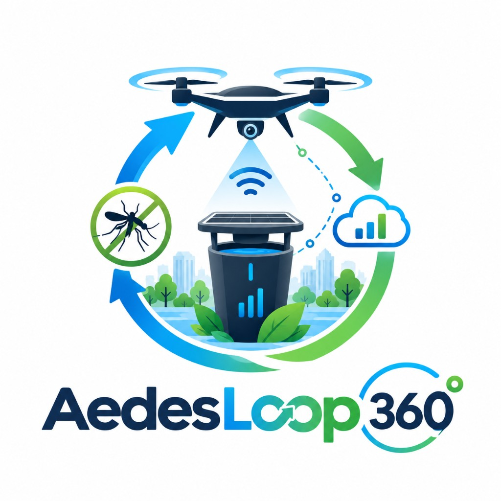
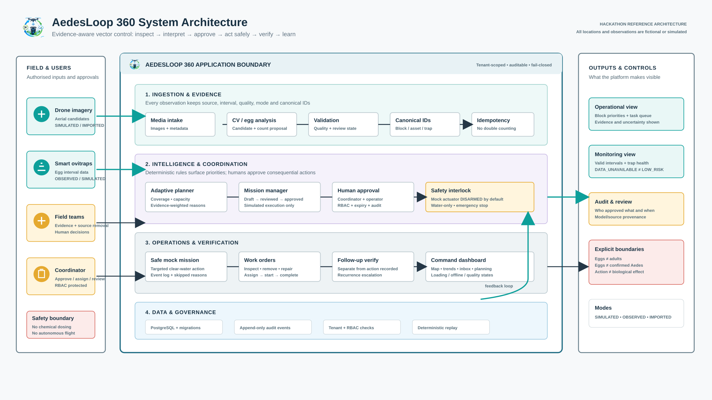
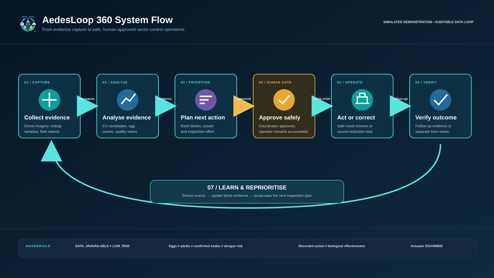

<p align="center">
  
</p>

<h1 align="center">AedesLoop 360</h1>

<p align="center"><strong>AI drone + smart ovitrap + township command dashboard, joined by one auditable data loop.</strong><br>
Local simulated demonstration &middot; human-approved &middot; no real spraying, no real flight</p>

## Overview

**Specification version:** 1.0 &middot; **README updated:** 2026-10-23  
**Status:** Final concept locked; hackathon MVP specification, not a certified mosquito-control product.

## The product

**AI Drone (Detect & Demonstrate Targeted Action) + Smart Ovitrap (Monitor & Count) + Township Command Dashboard (Analyse & Coordinate)** connected through a complete **observe → plan → inspect → supervised/mock intervene → monitor → re-plan → verify** loop.

**Primary track:** People (healthier Malaysian townships). **Secondary:** Planet (environmental management and restrained interventions).

The application must never claim that a container detection proves Aedes larvae, an egg-count trend proves dengue incidence, or that simulated treatment proves biological effectiveness. No pesticide dispensing and no unattended real drone operations in this MVP.

**Current repository status:** this is a local simulated demonstration. A configured local YOLOv8n checkpoint can detect candidate containers in uploaded images and persist `IMPORTED`/`UNCERTAIN` findings for human review. Without that checkpoint, the synthetic fixture and ground-review fallback remain available. The four-block ovitrap and mission loop uses simulated records; no real intervention is automated. See [`docs/IMPLEMENTATION_STATUS.md`](docs/IMPLEMENTATION_STATUS.md) for verified scenarios and remaining limits.

**Data evaluation status:** `docs/DATA_ANALYTICS_AND_EVALUATION.md`, `docs/DATA_IMPLEMENTATION_STATUS.md` and `docs/DATA_RESULTS_REPORT.md` document the analytics and model evidence. The local workspace contains user-supplied datasets and ignored checkpoints; these are not redistributed in Git. The drone evaluation card shows a persisted grouped held-out test run (mAP@0.5 68.30%, recall 62.54%). The ovitrap reviewer-assist card now shows a registered 57-image grouped held-out run (image MAE 9.56); zero-count specificity remains unmeasured. Dashboard surveillance reads persisted sample intervals; the strategy comparison is a labelled deterministic simulation.

## System architecture



Field inputs (drone imagery, smart ovitraps, field teams, coordinator) enter one tenant-scoped, RBAC-protected application boundary: ingestion and evidence, intelligence and coordination, operations and verification, and a data and governance layer (database, append-only audit, deterministic replay). The architecture is a modular monolith (`apps/web` Next.js, `services/api` FastAPI, a separate durable worker). Other views: [evidence-to-action loop](docs/aedesloop-architecture-slide.svg) and [enterprise layers](docs/aedesloop-enterprise-architecture.svg). Design detail is in [`docs/ARCHITECTURE.md`](docs/ARCHITECTURE.md).

## System flow



Evidence is captured, interpreted as *candidates*, reviewed and approved by a human, acted on only in a safe simulated mode, then verified separately and fed back into the next plan. Recording a treatment is never treated as proof that it worked. State rules are in [`docs/WORKFLOWS_AND_STATES.md`](docs/WORKFLOWS_AND_STATES.md).

## Current results at a glance

| Area | Latest recorded result | Source / caveat |
|---|---|---|
| Drone candidate detector (YOLOv8n, 417 grouped held-out images, 724 objects) | precision 69.59%, recall 62.54%, mAP@0.5 68.30%, mAP@0.5:0.95 50.45% | `docs/DATA_RESULTS_REPORT.md`. Other open containers recall only 27.96%; tyre (11) and coconut shell (15) test counts are tiny. Candidates only, not larvae or Aedes. |
| Ovitrap egg-count reviewer assist (57 images, 10 groups) | image MAE 9.56, group MAE 6.40, bias &minus;4.02 | Paddle photos only; zero-count specificity `NOT_EVALUATED`. Counts need human confirmation. |
| Allocation benchmark (4 blocks, 8 staff hours, simulated) | issues covered: uniform 4/8, static 3/8, adaptive 4/8 | Scripted simulation, not field data; adaptive does not win every metric. |
| Backend tests | 97 passed (`python -m pytest -q`, 2026-10-23) | Run on this working tree. |
| Browser tests | 24 passed, 1 skipped on a production build | From the earlier run recorded in `docs/IMPLEMENTATION_STATUS.md`; the working tree has changed since and Playwright was not rerun for this README update. |

Recently added: live detection and live egg-count preview panels, automatic detector pass after a simulated mission, model readiness in `/api/v1/health`, grouped navigation with one tab per task, a visual dashboard with a Leaflet map, and the 3D township view.

## Reading order for your coding agent

1. `AGENTS.md` — non-negotiable engineering rules and repository navigation.
2. `docs/PRD.md` — source of truth for product and requirements.
3. `docs/ARCHITECTURE.md` — deployable modular-monolith design and folder layout.
4. `docs/DOMAIN_AND_DATA.md` — canonical entities, invariants, data quality.
5. `docs/API_CONTRACT.md` — routes and request/response examples.
6. `docs/WORKFLOWS_AND_STATES.md` — state transitions and approval gates.
7. `docs/AI_AND_OPTIMISATION.md` — computer vision, egg counting, planning logic and evaluation.
8. `docs/SAFETY_PRIVACY.md` — spray, flight, privacy, trapping and safety constraints.
9. `docs/TEST_AND_ACCEPTANCE.md` — real acceptance cases and verification.
10. `docs/IMPLEMENTATION_PLAN.md` — build order and ownership.
11. `docs/DEMO_RUNBOOK.md` — 4-block reproducible judge demonstration.
12. `prompts/MASTER_BUILD_PROMPT.md` — copy/paste into Codex or another coding agent.
13. `prompts/REVIEW_AND_HARDEN_PROMPT.md` — second-pass engineering audit.

## Preferred architecture

- **One repository**, app-oriented structure: `apps/web` (Next.js App Router), `services/api` (FastAPI), `services/worker` (Python async/background tasks), `packages/contracts` (OpenAPI generated TS types), `packages/config`, `infra`, `docs`, `fixtures`.
- PostgreSQL + PostGIS, object storage for evidence images, backend-owned authorization and state transitions.
- Local Docker Compose for database/object storage; mock/simulated drone, ovitrap and actuator adapters work without paid external credentials.
- If an existing repository exists, **inspect and adapt it; do not overwrite or force this directory layout**. Preserve working features and migration history. Record deviations as ADRs.

## Intended end-to-end workflow

The target workflow is: use a seeded four-block demo, review candidate objects, approve and simulate an eligible harmless test-water action, ingest a new ovitrap interval, recompute priorities, create inspection work, then independently verify and escalate recurring accumulation. The local fixture workflow covers these persisted stages. The local upload-to-review path now persists an asset-linked fixture annotation for the exact synthetic image and an uncertain review item for unsupported images. It does not perform CV inference or infer real-world asset matching. See the implementation status for exact acceptance coverage.

## Run the local demo (Windows PowerShell)

The default demonstration uses SQLite, synthetic fixture evidence, a persisted mission worker and the local Next.js UI. No Docker service, external account or real actuator is required. Start each service in its own PowerShell window from the repository root.

**Terminal 1 — migrate, seed and start the API:**

```powershell
$repo = (Resolve-Path .).Path.Replace('\', '/')
New-Item -ItemType Directory -Force data | Out-Null
$env:AEDES_DATABASE_URL = "sqlite:///$repo/data/aedes-demo.sqlite"
python -m alembic -c services/api/alembic.ini upgrade head
Push-Location services/api
python -m app.seed
python -m uvicorn app.main:app --host 127.0.0.1 --port 8000
```

**Terminal 2 — start the durable simulation worker:**

```powershell
$repo = (Resolve-Path .).Path.Replace('\', '/')
$env:AEDES_DATABASE_URL = "sqlite:///$repo/data/aedes-demo.sqlite"
./scripts/start-worker.ps1
```

The worker script sets `AEDES_DRONE_MODEL_PATH`: when a simulated mission completes, the worker runs the drone detector once on each target image and records new `UNCERTAIN` candidates for ground review. Without the checkpoint the mission still completes and records `NOT_CONFIGURED`.

**Terminal 3 — install and start the web UI:**

```powershell
Set-Location apps/web
npm ci
npm run dev
```

The added `apps/web/package-lock.json` pins the npm dependency tree. Use `npm ci` for clean installs; use `npm install` when intentionally changing dependencies, then review the package and lockfile changes together.

Open `http://127.0.0.1:3000/dashboard` and click **Enter demo**. This opens the coordinator view without a role or password picker. Use **Switch to operator** in the top bar when you want to demonstrate simulated mission execution; switch back to coordinator for approvals. The API continues to enforce each role's permissions. The demo has two roles: **coordinator** (plans, approves, reviews counts, verifies outcomes, audit and settings) and **operator** (field operator: drone missions, uploads, site observations and assigned work). Local credentials are `<role> / demo-<role>-360`.

To reset the demo, stop the API and worker with Ctrl+C and use a new SQLite filename, for example `aedes-demo-reset-1.sqlite`, in the same `AEDES_DATABASE_URL` setting in the API and worker terminals. Run the migration and seed commands again. The previous database and audit history remain intact. Seeding an existing database is idempotent and preserves its records.

Run the automated checks from the repository root and `apps/web`:

```powershell
python -m pytest -q
ruff check services/api
Set-Location apps/web
npm run lint
npm run typecheck
npm run build
npm run test
```

Run the reproducible data inventory from the repository root:

```powershell
python scripts/data_evaluation.py validate-dataset --dataset local-app-fixture-images-v1 --out data/evaluations
python scripts/data_evaluation.py validate-dataset --dataset drone-aedes-habitat-candidate-v1 --out data/evaluations
python scripts/data_evaluation.py eval-drone --out data/evaluations
python scripts/data_evaluation.py eval-eggs --out data/evaluations
python scripts/benchmark_allocation.py --out data/evaluations/allocation-benchmark.json
```

The evaluation commands report `NOT_EVALUATED` until an independent labelled test set, predictions, and checkpoint are supplied. With those prerequisites, pass `--labels`, `--predictions`, `--checkpoint`, `--dataset-id` and `--split test` to the appropriate evaluator; then register its generated summary for the local demo tenant with `python scripts/register_evaluation.py --summary <path-to-summary.json> --tenant tenant-demo`. Registration checks the held-out split, sample count and dataset/checkpoint hashes before writing a tenant-scoped run record. A local registration still relies on the evaluator/operator to provide honest labels and predictions. On the dashboard, coordinators can run and persist the four-block simulated allocation comparison. The run compares uniform, stale static, and adaptive plans under shared scenario truth and budget; it is not field evidence.

The Playwright scenario expects the API, worker and web UI to be running. Install its browser once with `npx playwright install chromium`, or set `AEDES_BROWSER_EXECUTABLE` to an installed Chromium-compatible browser. For a side-by-side run when ports 3000/8000 are occupied, set `AEDES_API_ORIGIN` for Next.js, set `AEDES_WEB_ORIGIN` in both the API and Playwright process, and use a separate `AEDES_NEXT_DIST_DIR` for the second Next.js development server.

## Interactive 3D demonstration

Open **Township** for the new 3D walkthrough: select registered assets, inspect trap availability, replay saved mission events and explain the latest saved allocation. It uses existing backend records and preserves the 2D map. Geometry and drone travel are explicitly illustrative; replay cannot execute a mission. See [the 3D demo and validation guide](docs/3D_TOWNSHIP.md).

## Explicit exclusions

Unrestricted automatic chemical spraying, use of real live mosquitoes in demos, flight-control firmware or autopilot, autonomous drone flight, pesticide type/dose algorithms, medical/dengue infection risk prediction, public-health claims without field evidence, arbitrary third-party IP reuse, gamification, resident social features, untested cloud-only dependency.

## Evidence and context references

- [WHO Operational manual on larval source management (2026)](https://www.who.int/publications/i/item/9789240123212): integrated surveillance, container management, interventions, monitoring and evaluation.
- [CDC Aedes surveillance and control guidance](https://www.cdc.gov/mosquitoes/pdfs/mosquito-control-508.pdf): ovitrap interpretation, competing breeding habitats, sampling caveats.
- [CAAM UAS guidance](https://www.caam.gov.my/public/unmanned-aircraft-system-uas/): Standard ATF excludes spraying/dispensing; higher-risk operations need separate authorisations.

See `docs/SAFETY_PRIVACY.md` for how these limits are implemented in software.
