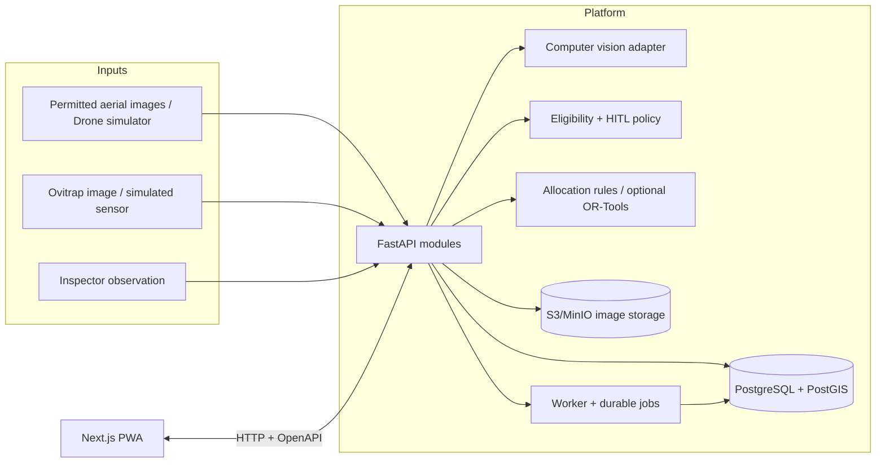

# Architecture — Modular Monolith with Ports & Adapters

## 1. Architectural decision

**Architecture name:** Modular monolith + clean/hexagonal architecture for domain boundaries; event-driven integration through persisted domain events/outbox where warranted. A monorepo houses web, API, worker and shared contracts. Avoid premature microservices or multi-agent platforms.

Why: four-person hackathon team needs independently developable components, consistent domain ownership, transactionally safe state changes, reliable demo startup and a realistic path to production without distributed-system overhead.

## 2. System diagram



No real aircraft flight interface. A **`DroneAdapter`** abstracts only simulation/recorded results. If a future flight integration is added, it requires a new reviewed ADR and separate deployment boundary.

## 3. Suggested repository structure (create only if existing repo permits)

```text
/
├── AGENTS.md
├── README.md
├── apps/
│   └── web/
│       ├── app/(app)/dashboard/
│       ├── app/(app)/township/
│       ├── app/(app)/drone/
│       ├── app/(app)/ovitraps/
│       ├── app/(app)/operations/
│       ├── app/(app)/planning/
│       ├── components/{ui,map,charts,missions,forms}/
│       ├── features/{blocks,drone,ovitraps,operations,planning}/
│       ├── lib/{api,auth,queries,format}/
│       ├── tests/{unit,e2e}/
│       └── ...configuration
├── services/
│   ├── api/
│   │   ├── app/
│   │   │   ├── main.py
│   │   │   ├── core/{config,security,errors,logging}.py
│   │   │   ├── db/{session,models}.py
│   │   │   ├── modules/
│   │   │   │   ├── blocks/{router,schemas,service,repository}.py
│   │   │   │   ├── assets/{router,schemas,service,repository}.py
│   │   │   │   ├── inspections/{router,schemas,service,repository}.py
│   │   │   │   ├── drones/{router,schemas,service,repository,adapters}.py
│   │   │   │   ├── ovitraps/{router,schemas,service,repository}.py
│   │   │   │   ├── planning/{router,schemas,service,repository}.py
│   │   │   │   ├── interventions/{router,schemas,service,repository}.py
│   │   │   │   └── audit/{router,schemas,service,repository}.py
│   │   │   ├── ml/{inference,model_registry,egg_counting}.py
│   │   │   └── integrations/{storage,notifications,telemetry}.py
│   │   ├── migrations/versions/
│   │   ├── tests/{unit,integration}/
│   │   └── pyproject.toml
│   └── worker/
│       ├── worker/{main,jobs,clock}.py
│       └── tests/
├── packages/
│   ├── contracts/                # generated OpenAPI-based TS types/client
│   └── config/
├── infra/{compose,db}/
├── fixtures/{four_block_scenario.json,images/}
├── docs/{PRD,ARCHITECTURE,DOMAIN_AND_DATA,API_CONTRACT,WORKFLOWS_AND_STATES,
│         AI_AND_OPTIMISATION,SAFETY_PRIVACY,TEST_AND_ACCEPTANCE,
│         IMPLEMENTATION_PLAN,DEMO_RUNBOOK}.md
├── prompts/{MASTER_BUILD_PROMPT,REVIEW_AND_HARDEN_PROMPT}.md
└── .github/{workflows,ISSUE_TEMPLATE}/
```

If repo already split into separate frontend/backend, retain that architecture: keep canonical contracts in API, share generated OpenAPI package through tagged artifact or CI job, and preserve a separate integration/infra repository **only if it already exists or is really needed**. Avoid splitting repositories by team member.

## 4. Backend module responsibilities

- **blocks/assets:** owns geographic inventory and tenant ownership; all evidence references canonical asset IDs.
- **inspections:** owns observation lifecycle, CV review state, accessible-source recording.
- **drones:** owns *planned and simulated* missions, targets, operator decision logs and abort handling; does not send real UAV flight commands.
- **ovitraps:** owns devices, collections, egg-sample uniqueness, quality, temporal aggregation and servicing.
- **interventions:** owns specific source-reduction, demo actions, follow-up and chronic defect referrals.
- **planning:** owns evidence-weighted priority, resource budgets, coverage floor, recommendations and reproducible plan versions.
- **audit:** append-only actor/action/event trail with correlation IDs and immutable simulated/observed mode.
- **ML adapters:** pure image-in/prediction-out, store model version and inference manifest. Train offline; never block safe fallback.
- **worker:** image processing tasks, scheduled stale-device checks, recurrence evaluation, retries and async notification work.

## 5. Work boundaries and data flow

1. Operator uploads image via signed upload or server-validated multipart route.
2. Image goes into private object storage, immutable evidence metadata in DB, safe processing job queued.
3. CV adapter returns candidate object classes + confidence + bbox + visibility / abstention; result persisted.
4. Eligibility engine records outcome `SKIP/INSPECT/DEMO_ELIGIBLE` based on evidence, policy and simulation mode; not chemical dosage.
5. Coordinator approves an eligible simulated mission; adapter emits ordered mission events.
6. Trap samples imported by interval; asynchronous egg count analysis, valid/invalid marks, rollups.
7. Planner reads *materialised valid observations and unresolved asset records*, writes versioned next-action recommendations.
8. User approves/delegates tasks; inspector records correction and follow-up. Recurrence emits engineering-review task.

## 6. Transaction boundaries, idempotency, outbox

- DB transaction creates mission approval + audit entry. Outbox publishes simulation event after commit.
- All telemetry/mission updates include unique `event_id` and `mission_id`. Reject conflicting duplicate; repeated identical submissions are idempotent.
- Every `OvitrapSample` has unique `(trap_id, interval_start, interval_end, sample_kind, source_sample_id)`; a corrected result is a new version tied to original, not a duplicate.
- No critical workflow relies on browser timers. Durable worker retries, dead-letter and visible failed state.

## 7. API and frontend boundary

Use REST JSON with `/api/v1`; generated TS clients from exported OpenAPI. TanStack Query optional for caching, server components for stable page data, client components for maps/interactive chart. All mutations through API; UI state is not authoritative. Use event polling for demo; WebSocket or SSE optional only after core works.

## 8. Environments

`local`: Compose DB + storage + seeded fixtures + fake drone and camera, no keys beyond local dev; `demo`: deterministic hosted instance with `SIMULATED` display; `pilot`: must not be enabled without safety/privacy and partner reviews. Do not create production drone/pesticide routes in demo.

**Operational CLI ideal:** `make dev`, `make seed`, `make test`, `make demo-reset`, `make openapi`. This repository uses npm for the web app; document only commands that exist and have been verified.

## 9. Architecture decision record

Document deviations in `docs/adr/ADR-001-modular-monolith.md` or new ADRs, recording context, options, chosen solution, tradeoffs and test evidence.
