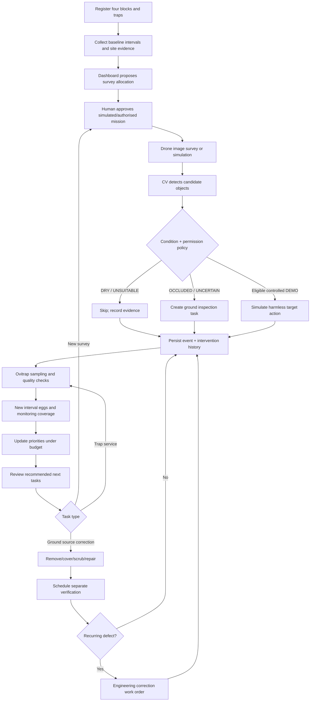

# Workflows, State Machines and HITL Gates

## 1. End-to-end operational loop

## 2. Drone mission states

`DRAFT → READY_FOR_REVIEW → APPROVED → SIMULATING → {COMPLETED | ABORTED | FAILED}`; rejection `READY_FOR_REVIEW → REJECTED`. `ABORTED`, `FAILED`, `COMPLETED`, `REJECTED` terminal; new mission for retries.

- Approver records actor/time/reason/checklist/policy version. Owner cannot use client-only state to bypass.
- Simulate action only if mission `APPROVED`, `mode=SIMULATED`, zone is fictional approved test and every requested target remains eligible.
- Mission simulation may be aborted; record targets actually visited; no inferred completion for pending targets.
- Aerial inspection events `PLANNED`, `IMAGE_OBSERVED`, `CANDIDATE_DETECTED`, `SKIPPED`, `MOCK_ACTION_RECORDED`, `MISSION_COMPLETED`. All `source_mode` explicit.

## 3. Candidate / site assessment

`DETECTED → QUALITY_CHECKED → {DRY_SKIP | UNCERTAIN_REVIEW | POSSIBLE_WATER_INSPECT | MOCK_ELIGIBLE}`.

Any `OCCLUDED`, poor image, unknown legal access or unsupported class → no automatic mock action; ground review or skip. **Never issue chemical application instructions.** Confirmed water at site still need not be appropriate for spraying: surface removal/covering/repair often preferred.

## 4. Ovitrap sample states

`RECEIVED → PROCESSING → {VALID | INVALID | NEEDS_REVIEW}`. `VALID` is an observation-quality category, not entomological species confirmation. Correction produces a revised sample version/superseding pointer; original audit stays accessible.

Device `ACTIVE → STALE → OFFLINE`; `SERVICING_DUE`/`UNSAFE` overrides valid new operational claims until addressed. `OFFLINE` triggers equipment-service task and never counts as zero eggs.

## 5. Work order and intervention states

`OPEN → ASSIGNED → IN_PROGRESS → ACTION_COMPLETED_PENDING_VERIFICATION → {VERIFIED_RESOLVED | REOPENED | REFERRED_TO_ENGINEERING}`; allow `CANCELLED` with authorised reason. Do not label an asset fixed solely from worker tapping “complete”.

Recurring water accumulation e.g. **>=2 separately verified repeat issues within a configurable window** triggers review flag and engineering referral. Threshold is a proposed *software policy parameter*, not a scientific larval breeding threshold. Test threshold boundaries and avoid duplicate work orders.

## 6. Human-in-the-Loop: approval matrix

| Decision | Automated | Human action |
|---|---|---|
| Upload and score image | Yes | Low confidence may request review |
| Count eggs for sample | Yes | Review ambiguous images/quality as needed |
| Rank block inspection priorities | Yes | Manager chooses operational plan |
| Propose mission | Yes | Drone coordinator approves operation |
| Simulate harmless target action | Yes, after approved demo state | Observer can stop instantly |
| Real drone flight | Not in MVP | Qualified operator and required regulatory approvals |
| Real pesticide dispensation | Not in MVP | Qualified/licensed programme and applicable approvals |
| Remove water-holding container/repair | Create task | Responsible worker does physical work |
| Confirm corrected source | Suggest | Qualified reviewer verifies field evidence |

## 7. Negative path requirements

- Trap goes offline → dashboard shows `DATA_UNAVAILABLE`, device service task, no numerical risk ranking from missing data.
- Aerial photo has occlusion → `GROUND_REVIEW`; no spray event.
- Wrong/expired approval → 409, event recorded; cannot simulate.
- Sensor replay → idempotently ignored/count unchanged.
- Mission aborted → unvisited targets remain unacted; no success claim.
- Repeated accumulation → engineering review, not endless additional pesticide suggestions.
- CV fails → deterministic labelled fixture flow continues with prominently marked fallback.

## 8. UI event semantics

Use precise verbs: `detected`, `suggested`, `reviewed`, `approved`, `simulated`, `observed`, `action completed`, `verified condition resolved`. Avoid `eradicated`, `cured`, `safe from dengue`, `all eggs killed`. Show timestamps, source and last refresh on detail views.
